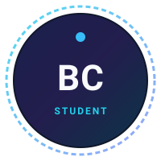

# Bijjam Charan Kumar Reddy - Personal Portfolio

A modern, responsive, high-performance personal portfolio website built with clean **HTML5**, **CSS3**, and **vanilla JavaScript**. 

This portfolio honestly highlights my current learning journey as a **second-year engineering student with intermediate Python skills**, building small, practical command-line (CLI) and graphical (GUI) projects.

---

## 🌟 Highlights & Features

- **Accurate & Honest Representation**: Accurately reflects second-year coursework and practical Python learning without exaggerated titles or fabricated credentials.
- **Modern Visual Identity**: Polished dark background with rich indigo and purple gradients, cyan highlights, and frosted glass cards (`backdrop-filter`).
- **Full Dark / Light Theme System**:
  - Automatically respects user OS preference (`prefers-color-scheme`).
  - Smooth theme switcher with persistent storage in `localStorage`.
  - Accessible contrast ratios in both themes.
- **Dynamic Role Text**: Smooth typing animation cycling through learning milestones.
- **Interactive Projects Showcase**:
  - Real-time search across project titles and descriptions.
  - Category filters: **All**, **CLI**, and **GUI**.
  - Combined search + category filtering with dedicated zero-match empty state.
- **Demo Code Preview Modal**:
  - Monospace code viewer with custom sample demonstration Python code for all 4 projects.
  - Copy-to-clipboard button with visual feedback and fallback for secure/local file contexts.
  - Fully accessible dialog: keyboard focus trap, `Escape` key dismissal, outside-click closing, and focus return.
- **Stats Section**: Real milestones with viewport reveal animations.
- **Validated Contact Form**:
  - Live client-side field validation.
  - Clear static-site disclaimer (no fake submission claims) plus an instant **"Open in Email App"** pre-filled `mailto:` link generator.
- **Zero External Dependencies**:
  - Runs 100% offline directly from disk without Node.js, Vite, npm, React, or CDN dependencies.
  - Crisp inline SVG icons for instant rendering without font downloads.

---

## 📁 Project Structure

```
Portfolio-Showcase/
├── index.html              # Website layout, semantic structure, and content
├── css/
│   └── style.css           # Styling, design tokens, light/dark themes, glassmorphism, responsive queries
├── js/
│   └── script.js           # Theme toggle, typing effect, search/filter, code modal, form validation
├── assets/
│   └── images/
│       └── avatar.svg      # Clean initials-based avatar monogram (replaceable)
└── README.md               # Documentation and customization guide
```

---

## 🚀 How to Run the Website

Because this portfolio uses pure vanilla web technologies, no build tools, compilers, or local web servers are required.

### Option 1: Direct File Open
1. Navigate to the project directory:
   ```
   C:\Users\bijja\Portfolio-Showcase\
   ```
2. Double-click `index.html` (or right-click -> Open with Chrome / Edge / Firefox / Safari).

### Option 2: Local HTTP Server (Optional)
If you prefer running through a local development server:
```bash
# Using Python 3's built-in HTTP server:
python -m http.server 8000
```
Then open `http://localhost:8000` in your web browser.

---

## 🛠️ How to Customize

### 1. Social & Repository Links
The website is currently configured with your exact profile and repositories URLs:
- **GitHub Repositories**: `https://github.com/bijjamcharan09-cyber?tab=repositories`
- **LinkedIn Profile**: `https://www.linkedin.com/in/charan-kumar-reddy-bijjam-999b5a394/`
- **Email**: `bijjamcharan09@gmail.com`

### 2. Add Your Own Profile Picture
To replace the default initials monogram with your real photograph:
1. Place your photo inside `assets/images/` (for example, `assets/images/profile.jpg`).
2. In `index.html`, locate the avatar image tag around line 108:
   ```html
   <!-- Change from: -->
   

   <!-- Change to: -->
   
   ```

### 3. Update or Add Projects
Each project card in `index.html` uses data attributes for filtering and search:
```html
<article class="glass-card project-card" 
  data-type="gui" 
  data-title="Your Project Title" 
  data-desc="Your short description.">
  ...
</article>
```
To update the demo code preview shown in the modal for any project, edit the `sampleProjectsCode` dictionary in `js/script.js`.

### 4. Connect a Contact Form Backend (Optional)
Currently, submitting the form validates the fields and provides a pre-filled `mailto:` link to `bijjamcharan09@gmail.com`. If you wish to receive form submissions directly via an email service in the future, you can integrate services such as:
- [Formspree](https://formspree.io/)
- [EmailJS](https://www.emailjs.com/)
- [Web3Forms](https://web3forms.com/)

Simply set the `action` and `method="POST"` attributes on `<form id="portfolioContactForm">`.

---

## 📄 License & Attribution

Designed and built for **Bijjam Charan Kumar Reddy**. Free to customize and adapt for educational and personal portfolio purposes.
